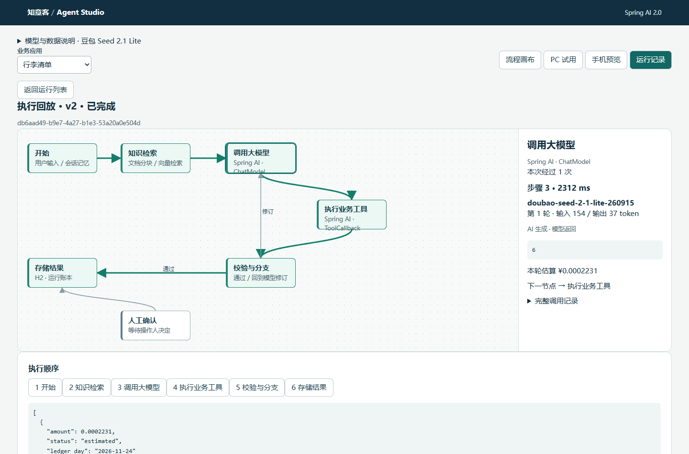
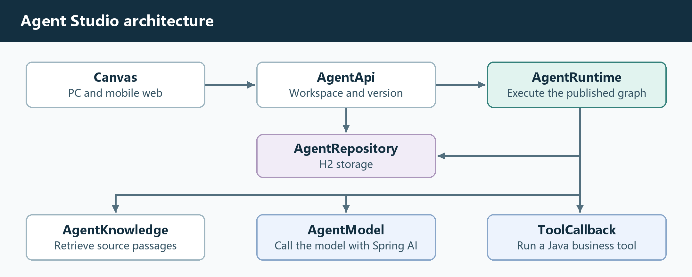

# Agent Studio

**English** · [简体中文](README.zh-CN.md) · [Deutsch](README.de.md)

Agent Studio runs the workflows you publish on a visual canvas using **Spring AI 2.0.3**. In the packing workflow, for example, a user describes a trip, the retriever finds packing guidance, the model extracts the number of days, and a Java tool calculates clothing quantities. Desktop and mobile use the same published graph. Each run records the path it took.

[Open the live workbench](https://aitools.ynsmhy.com/open-source/) · [Try the mobile view](https://aitools.ynsmhy.com/open-source/lab/agent/?mobile=1&app=packing-list) · [v0.2.0 source](https://github.com/hellomaybe/Agent-Studio/tree/v0.2.0)

## Run the packing agent

1. Open the [packing workflow](https://aitools.ynsmhy.com/open-source/lab/agent/?app=packing-list). Select the tool node **执行业务工具** and set **途中洗衣** to **可以洗衣** (laundry available). Save the draft (**保存草稿**), then publish it (**发布流程**).
2. Under **PC 试用**, enter `出行六天，请输出天数` (“a six-day trip”) and click **运行 Agent**. When the model extracts six days, the tool returns **2 tops and 3 items of underwear**. In **手机预览** (mobile preview), enter `9`. With the same published rule, the result is **3 tops and 5 items of underwear**.
3. Open **查看执行画布** to replay the run. Select the retrieval node to inspect the source passages and scores, the model node for its prompt, response, latency and tokens, or the storage node for the result written to H2. Earlier runs keep their original graph version.



## Five runnable agents

| Agent | What to try |
| --- | --- |
| Quote calculator | Extract line items, quantities and prices. Change the tool’s tax rate and compare the tax and total calculated by the Java engine. |
| Batch file renaming | Change the naming template and preview the new names. The default graph waits for approval before saving the result. Files on your device are untouched. |
| Packing list | Extract the trip length and calculate quantities with or without laundry. The model node also supports a native call to the packing tool. |
| Subtitle timeline | Check cue timings or apply a repair, then compare an overlap with the resulting timestamps. |
| Title checker | Retrieve publishing guidelines, generate a title and check it against platform rules. A failed check can loop back for revision within the call and budget limits. |

The hosted demo uses **Doubao Seed 2.1 Lite**. Each browser gets a private one-hour workspace. Hosted retrieval uses local sparse vectors; self-hosted installations can connect an embedding service and cache its index in H2. The hosted service shares a **CNY 10 daily estimated budget**, reset on the UTC day boundary. Model-backed runs send the input, selected passages and relevant context to the provider. Use sample data.

## Architecture



Publishing pins the prompt, retrieval settings, tool input bindings and edges. Each run loads a specific graph version. A failed check can send feedback to the model for another attempt, and a batch rename can pause for approval. The run ID links the original graph to the path taken and the stored result. [Graph definition](agent-workbench/src/main/java/studio/lab/AgentGraph.java) · [Runtime](agent-workbench/src/main/java/studio/lab/AgentRuntime.java)

| Stage | How Spring AI 2.0.3 and the workbench fit together |
| --- | --- |
| Retrieval and context | The hosted service retrieves passages from workspace documents. Self-hosted installations can generate embeddings with `OpenAiEmbeddingModel` and cache the index in H2. The workbench adds the matching text, its source and an optional summary of the last result to the prompt. |
| Inference and tools | `OpenAiChatModel.call(Prompt)` sends the model request. In native tool-calling mode, the runtime checks the returned function name and arguments, then dispatches the workflow’s permitted Java tool through `ToolCallback`. |
| Budget and replay | The workbench reserves budget before the call and estimates cost from the provider’s input and output token counts at the configured rates. Replay exposes model usage, branch decisions and the stored result. |

**One recorded call.** In a hosted test for a nine-day trip, retrieval found the packing guidelines and Doubao requested `packing_list({"text":"9"})`. The Java tool calculated quantities under the published laundry rule. The provider reported 619 input tokens and 208 output tokens for that call, an estimated CNY 0.0010568. [Architecture walkthrough and source map (Chinese)](docs/architecture.zh-CN.md)

## Run the Agent workbench locally

Install JDK 17 and Maven. Set a private database password in the server environment variable `AGENT_DEMO_DB_PASSWORD`, then run these commands from the repository root:

```sh
mvn -f agent-workbench/pom.xml verify
cd agent-workbench
java -jar target/agent-workbench-0.2.0.jar site
```

Open the [local canvas](http://127.0.0.1:29479/open-source/lab/agent/). Without a chat model, new templates can run their tools on structured input. To enable real model calls, configure the provider endpoint, model, credentials, rates and budget on the server. [Workbench configuration and tests](agent-workbench/README.md)

<details>
<summary>Meeting and feedback editor — setup, debugging and developer guide</summary>

Agent Studio is a visual editor for building and running AI workflows on your own machine. Connect nodes on a Vue Flow canvas, map fields between steps, and pause a run for human approval. The Java backend keeps track of versions and resumes waiting runs. Model nodes use Spring AI 2.0.3. Try the two built-in workflows without an API key.

| Local workflow | What to try |
| --- | --- |
| [Meeting action items](http://127.0.0.1:5173/#/apps/meeting-notes) | Extract tasks from meeting notes and keep the ones with an assignee. When their count reaches the threshold, review the tasks and save your selection to the local run record. |
| [Feedback triage](http://127.0.0.1:5173/#/apps/feedback-triage) | Route feedback using keywords you can change. Urgent feedback goes to a reviewer and becomes a local ticket on approval. Routine suggestions go straight to the end of the workflow. |
| [Legacy meeting workflow](http://127.0.0.1:5173/#/legacy) | Open the original template, drafts, pending approvals, and task previews. View or copy a read-only graph reconstructed from a historical configuration. |

The two current workflows share an editor and runtime. Each comes with a published version you can run immediately. Moving a node changes its position on the canvas. The `from / port / to` connections determine execution order, and field mappings determine where each input comes from.

## Run locally

Install JDK 17, Maven 3.9, npm, and either Node.js 22.12 or Node.js 24 LTS. Open two terminals in the repository root.

Before the first start, choose a local database username and a strong password and save them in your password manager. Use the same credentials when reopening the H2 database. For MySQL, use the credentials of your own dedicated database account. In the backend terminal, set them without typing the password into a command or storing it in the repository.

PowerShell 7.1+

```powershell
$env:STUDIO_DB_USERNAME = Read-Host 'Database user'
$env:STUDIO_DB_PASSWORD = Read-Host 'Database password' -MaskInput
```

Bash

```bash
read -r -p 'Database user: ' STUDIO_DB_USERNAME
read -r -s -p 'Database password: ' STUDIO_DB_PASSWORD
printf '\n'
export STUDIO_DB_USERNAME STUDIO_DB_PASSWORD
```

Start the backend in the first terminal. It listens on `127.0.0.1:8080`. On first startup, Flyway creates the tables and loads both workflow graphs, published versions, evaluation samples, and the legacy meeting draft.

```sh
cd backend
mvn spring-boot:run
```

Start the frontend in the second terminal, then open the [local editor](http://127.0.0.1:5173). The development server forwards `/api` requests to the backend.

```sh
cd frontend
npm ci
npm run dev
```

### Try your first run

1. In the meeting workflow, open **运行与恢复** (Run and resume) and run **含负责人和待分配事项** (assigned and unassigned tasks). The default filter keeps Alice’s task. When the run pauses, refresh the page or reopen its URL. Select the task, confirm it, and inspect the path and the saved task.
2. In feedback triage, run **紧急反馈** (urgent feedback) and **普通建议** (routine suggestion). Approving the urgent case creates a local ticket. The routine case finishes immediately. Use the operation ID to check the result. Both samples run without an external ticketing or messaging service.
3. In **流程编排** (Workflow editor), raise the filter’s minimum task count from one to two. You can also add nodes or change connections and field mappings. Save the draft, then compare the same samples under **对比与发布** (Compare and publish). A single assigned task can now skip approval. Check the workflow and its assertions against the intended behavior before publishing. Runs already in progress keep their original version.

### Debug and publish a workflow

Select **调试此节点** (Debug this node) in the node settings. Pin an input and run both the published and draft versions of the node against it. Compare field mappings, outputs, branches, proposed actions, and timings. You can reuse output from an upstream node you have tested, or explicitly select stored input from a run in the replay view. Node debugging and pre-release evaluation preview actions. A full workflow run, including a sample run, saves local action records.

Use samples to test filters, branching, and approval rules. To compare two prompts on the same meeting text, enable live calls, open `extract-tasks`, and confirm each version’s live test separately. Inspect the outputs and the usage reported by the provider. Each call can incur a charge. Feedback triage uses keyword rules.

Drafts and evaluation suites each have a revision number. Before publishing, run the saved evaluation samples against the current saved graph. If a concurrent edit causes a conflict, load the latest revision. A published version fixes the nodes, connections, mappings, settings, and capability versions for that run. [Storage, recovery, and API (Chinese)](docs/storage-and-api.md) · [Adding a node (Chinese)](docs/node-extensions.md)

## Code and storage

| Path | Contents |
| --- | --- |
| `backend/src/main/resources/db/migration/` | Flyway migrations for legacy and current graphs, published versions, runs, usage, and evaluation data. |
| `backend/src/main/java/studio/agent/graph/`, `quality/`, `workflow/` | Node registry, graph validation, sample comparisons, publishing, background execution, and resuming runs on a signal. |
| `backend/src/main/java/studio/agent/extensions/` | An example domain-specific node, `FilterAssignedNode`. |
| `backend/src/main/java/studio/agent/meeting/` | Legacy meeting API, run snapshots, and approval transactions. |
| `backend/src/main/java/studio/agent/model/` | Structured model output and usage tracking through Spring AI’s OpenAI-compatible interface. |
| `frontend/src/` | Editor, canvas, node settings, replay, sample evaluation, and HTTP client. |
| `backend/src/test/`, `frontend/e2e/`, `tests/` | Java regression tests, browser workflows, and persistence checks across separate JAR processes. |

By default, H2 stores its files in `data/` under the **backend process’s working directory**. Restart the backend from the same directory to resume earlier runs. The database may contain prompts, inputs, task results, and run snapshots. The local operator manages access and backups. For live runs in the current workflows, you must agree to store content for 24 hours. Sample runs, legacy history, and backups have separate retention rules.

To use MySQL, prepare an empty database and a user with privileges limited to that database. Build and run the MySQL variant from the repository root.

```sh
cd backend
mvn -Pmysql verify
java -jar target/agent-studio-backend-0.1.0-SNAPSHOT-mysql.jar
```

Before starting the JAR, set `STUDIO_DB_URL` to the JDBC URL and configure `STUDIO_DB_USERNAME` and `STUDIO_DB_PASSWORD`. The default `mvn verify` build uses H2. The MySQL profile also bundles the MySQL driver and the Flyway MySQL module.

## Connect a model

To extract tasks with a live model, enable live calls and set the provider credentials in the **backend environment**. Restart the service and select **真实模型** (Live model) in the editor. Fixed samples test field mappings and branches. Use a live model to evaluate prompt quality.

| Variable | Purpose |
| --- | --- |
| `STUDIO_LIVE_ENABLED` | Set to `true` to allow live calls. Disabled by default. |
| `STUDIO_MODEL_API_KEY`, `STUDIO_MODEL_NAME` | Your provider API key and model name. |
| `STUDIO_MODEL_BASE_URL` | Defaults to `https://api.openai.com/v1`. Set the API base URL for another compatible service. Local models can use a loopback HTTP address. |
| `STUDIO_MODEL_TOKEN_FIELD` | Defaults to `max_completion_tokens`. Set to `max_tokens` for providers that require the older parameter. |
| `STUDIO_LIVE_DAILY_LIMIT` | Maximum number of live calls per rolling 24-hour period. Defaults to `5`, shared across current workflows, the legacy workflow, and live node tests. |

Live calls send the mapped text to the configured provider and may incur charges. Keep credentials on the server and access Agent Studio through the loopback interface. Serving multiple users or exposing it on the internet requires a design for authentication, data ownership, and access control.

## Build and test

In `backend/`, run `mvn spotless:apply` to format Java and `mvn verify` to check formatting, run regression tests, and build the JAR. In `frontend/`, run `npm run format` to format the code, `npm run format:check` to check it, and `npm run build` to type-check and build the app.

To verify a source build, start in the repository root.

```sh
mvn -f backend/pom.xml verify
python tests/check_persistence.py
cd frontend
npm ci
npm run build
npx playwright install chromium
npm run test:e2e
```

Browser tests start their own services and an in-memory database on loopback ports 18181 and 14173. The MySQL persistence test requires Docker. From the repository root, run `mvn -f backend/pom.xml -Pmysql verify`, then `python tests/check_persistence.py --mysql`. The script starts a temporary MySQL 8.4 container, starts the same backend JAR twice, and checks drafts, snapshots, and approval results across the restart.

SQL formatting rules are in `.sqlfluff`. Run `sqlfluff lint backend/src/main/resources/db/migration` to check migrations. CI uses SQLFluff 3.4.2.

</details>

## License

The original code in Agent Studio Community Edition is licensed under the [Apache License 2.0](LICENSE). Third-party components retain their own licenses and attribution notices. [Third-party notices](THIRD_PARTY_NOTICES.md)
