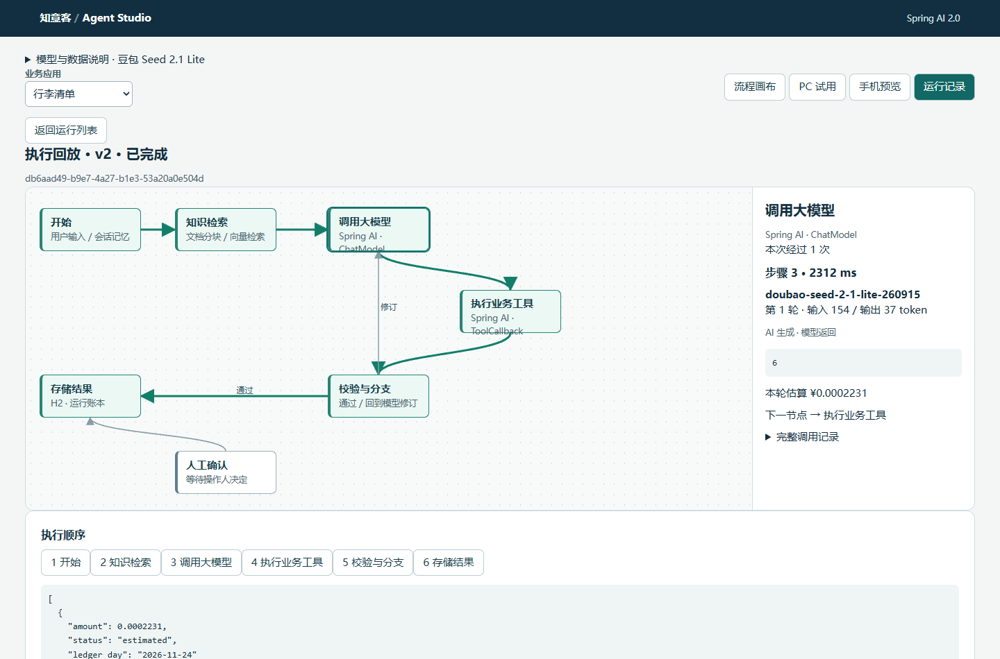
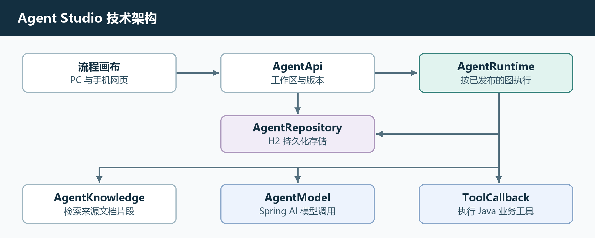

# Agent Studio

[English](README.md) · **简体中文** · [Deutsch](README.de.md)

Agent Studio 用 **Spring AI 2.0.3** 把画布上发布的流程交给后端执行。以行李清单为例：用户输入行程，知识检索节点找到打包规范，模型提取天数，Java 工具计算衣物数量。PC 和手机网页使用同一个发布版本，每次运行都能沿实际经过的节点回放。

[打开在线画布](https://aitools.ynsmhy.com/open-source/) · [手机网页体验](https://aitools.ynsmhy.com/open-source/lab/agent/?mobile=1&app=packing-list) · [v0.2.0 源码](https://github.com/hellomaybe/Agent-Studio/tree/v0.2.0)

## 跑一次行李清单 Agent

1. 在[行李清单画布](https://aitools.ynsmhy.com/open-source/lab/agent/?app=packing-list)点 **执行业务工具**，把「途中洗衣」设为「可以洗衣」。点击 **保存草稿**，再点 **发布流程**。
2. 在 **PC 试用** 输入 `出行六天，请输出天数`，点击 **运行 Agent**。当模型提取出 6 天时，工具返回 **2 件上衣、3 件内衣**。切到 **手机预览**，输入 `9`，同一配置会得到 **3 件上衣、5 件内衣**。
3. 点击 **查看执行画布**。选「知识检索」看命中文档、原文和分数；选「调用大模型」看提示词、返回值、耗时及 token；选「存储结果」看写入 H2 的业务结果。历史运行始终引用当时发布的图。



## 五个可运行的 Agent

| 应用 | 在画布上可以验证什么 |
| --- | --- |
| 报价计税 | 从报价明细提取项目、数量和单价；切换工具节点税率，比较计算器返回的税额与合计。 |
| 批量改名 | 更换命名模板，预览新文件名；默认路径等待人工确认后保存结果。访客磁盘上的文件保持原样。 |
| 行李清单 | 从行程提取天数，用洗衣条件计算数量；模型节点还支持让模型原生请求行李工具。 |
| 字幕时间轴 | 检查字幕时间段，或运行修复规则；比较原始重叠位置与输出时间。 |
| 标题检查 | 检索发布规范、生成候选标题并调用规则引擎；校验失败可沿回边修订，模型轮数和预算限制循环。 |

官网演示使用 **豆包 Seed 2.1 Lite**，每个浏览器的独立工作区有效期为一小时。公网 RAG 使用本地稀疏向量；自托管版可配置 Embedding 服务并在 H2 缓存索引。演示服务共享每天 **10 元**的估算预算，按 UTC 日重置。带模型节点的流程会把输入、选中的知识片段及相关上下文发送给模型供应商，请使用演示资料。

## 技术架构



发布时，工作台保存提示词、检索设置、工具输入绑定和节点连线。提交任务时，后端读取指定版本。校验失败可以带着原因回到模型节点；批量改名可停下来等待人工确认。每个运行编号都能找回当时的图、实际路径和结果。[图定义](agent-workbench/src/main/java/studio/lab/AgentGraph.java) · [执行器](agent-workbench/src/main/java/studio/lab/AgentRuntime.java)

| 环节 | Spring AI 2.0.3 与工作台如何配合 |
| --- | --- |
| 检索与上下文 | 官网从当前工作区检索文本片段，自托管版可用 `OpenAiEmbeddingModel` 生成向量并在 H2 缓存索引。工作台把命中原文、来源和可选的上次结果摘要加入提示词。 |
| 推理与工具 | `OpenAiChatModel.call(Prompt)` 发起模型请求。在原生工具调用模式下，工作台检查模型返回的函数名和参数，再通过 `ToolCallback` 执行当前流程授权的 Java 工具。 |
| 预算与回放 | 工作台在请求前预留预算，按供应商返回的输入、输出 token 和配置单价估算费用。模型用量、分支选择和存储结果均可在运行回放中核对。 |

**一次真实调用：** 在九天行程的公网验收中，检索命中《出行打包规范》，豆包请求 `packing_list({"text":"9"})`。Java 工具按已发布的洗衣规则计算件数。该轮实际返回 619 个输入 token 和 208 个输出 token，估算费用为 0.0010568 元。[完整架构说明与源码索引](docs/architecture.zh-CN.md)

## 生产环境为何选用 Spring AI 2.0.3

以报价为例：模型从输入中提取项目、数量和单价，既有的 Java 计税引擎负责金额与舍入。用 Spring AI 接入模型后，工作流可以在同一 JVM 内通过 `ToolCallback` 调用原有引擎。调整一次计税规则，自托管工作台和线上流程就能随版本交付同一份实现。项目锁定 2.0.3，让部署者可以复现已经验证的模型请求、函数参数和用量读取行为。[模型适配器](agent-workbench/src/main/java/studio/lab/AgentModel.java) · [业务工具](agent-workbench/src/main/java/studio/lab/Features.java)

Python 同样能承载生产 Agent。对这个已有五个 Java 工具的项目，采用 Python 编排意味着要决定如何复用它们：重写规则需要验证两份实现的结果一致；保留 Java 服务并通过网络调用，则要处理接口版本、超时和重试。如果团队已有 Python 工具和运维体系，这笔成本就会不同。无论选择哪种栈，重复提交、人工审批、工作区隔离和费用核对都要单独验证。[生产选型详解](docs/architecture.zh-CN.md#生产选型) · [Python LangGraph 持久化机制](https://docs.langchain.com/oss/python/langgraph/persistence)

## 本机启动 Agent 画布

需要 JDK 17 和 Maven。先在服务端环境变量 `AGENT_DEMO_DB_PASSWORD` 中设置自己的数据库密码，再从仓库根目录执行：

```sh
mvn -f agent-workbench/pom.xml verify
cd agent-workbench
java -jar target/agent-workbench-0.2.0.jar site
```

打开[本机画布](http://127.0.0.1:29479/open-source/lab/agent/)。未配置聊天模型时，新模板可直接用结构化输入执行业务工具。要启用真实模型调用，请配置服务端模型地址、模型名、凭证、单价及预算。[工作台配置与测试说明](agent-workbench/README.md)

<details>
<summary>会议待办与反馈分流编辑器：启动、调试与开发指南</summary>

Agent Studio 是一个面向本机单操作者的流程编辑器。业务人员在 Vue Flow 画布上选择能力、连接分支、映射字段和运行样例。Java 服务负责版本、执行、等待与恢复，模型节点通过 Spring AI 2.0.3 调用供应商。首次体验可以使用内置样例，无需密钥。

| 入口 | 可以体验的流程 |
| --- | --- |
| [会议待办](http://127.0.0.1:5173/#/apps/meeting-notes) | 从会议文本提取事项，筛选已分配负责人的任务，达到门槛后由用户确认。选中的事项写入本地运行结果。 |
| [反馈分流](http://127.0.0.1:5173/#/apps/feedback-triage) | 按可配置关键词分类。紧急反馈经人工审核后可写入本地工单，普通反馈直接结束。 |
| [旧版会议运行](http://127.0.0.1:5173/#/legacy) | 保留原会议模板、草稿、待确认运行和任务预览。可查看或复制按旧配置还原的只读历史图。 |

两个新版应用共用同一个编辑器和运行时。首次运行的已发布图可直接用于体验。节点的画布位置只影响布局，`from / port / to` 控制执行顺序，字段绑定决定数据来源。

## 本地启动

准备 JDK 17、Maven 3.9、Node.js 22.12 或 24 LTS 及 npm。从本目录开始，在两个终端分别运行以下命令。

首次启动前，请为本地数据库自选用户名和强密码，并保存在密码管理器中。再次打开同一 H2 数据库时使用相同凭证。MySQL 使用你为独立数据库创建的专用账号。在后端终端中用下面任一方式输入凭证，密码不会写入命令历史或仓库。

PowerShell 7.1+

```powershell
$env:STUDIO_DB_USERNAME = Read-Host 'Database user'
$env:STUDIO_DB_PASSWORD = Read-Host 'Database password' -MaskInput
```

Bash

```bash
read -r -p 'Database user: ' STUDIO_DB_USERNAME
read -r -s -p 'Database password: ' STUDIO_DB_PASSWORD
printf '\n'
export STUDIO_DB_USERNAME STUDIO_DB_PASSWORD
```

后端默认监听 `127.0.0.1:8080`，Flyway 会在首次启动时建表，并写入两个应用的初始图、发布版本、验收样例及旧版会议草稿。

```sh
cd backend
mvn spring-boot:run
```

前端将同源的 `/api` 请求代理到后端。打开 [本地工作台](http://127.0.0.1:5173)。

```sh
cd frontend
npm ci
npm run dev
```

### 第一次运行

1. 打开“会议待办”的“运行与恢复”，选择样例“含负责人和待分配事项”并启动。默认规则会保留 Alice 的事项。进入等待后，可复制地址或刷新页面，再勾选并确认。查看实际路径和本地任务记录。
2. 切换到“反馈分流”，分别运行“紧急反馈”和“普通建议”。前者进入审核，批准后写入本地工单记录。后者在结束节点返回。运行结果中的操作编号可用于核对，应用没有配置外部工单平台或消息渠道。
3. 在“流程编排”中选中筛选节点，调整“进入确认的最少条数”，或新增节点、修改连线和输入映射。保存草稿，在“对比与发布”中检查同一批固定样例的结果。门槛改变后，原先只有一条合格待办的样例可能直接结束。根据业务预期检查流程或验收断言，通过后再发布。已启动的运行继续引用各自的版本。

### 调试与发布

在节点配置中点击“调试此节点”。可以固定一份输入，在同一输入上分别执行发布版和候选节点，比较输入映射、输出字段、分支、拟执行操作和耗时。上游字段可取自已调试过的上游输出；真实运行中留存的节点输入需要在回放中明确选择读取。单节点调试和发布前样例评估只返回拟执行操作。新版完整运行会在工作台数据库保存本地操作记录，样例模式同样会保存。

判断分支、筛选和确认规则可先用样例调试。若要比较两个提示词在同一段真实会议文本上的提取效果，在启用模型后进入 `extract-tasks` 的真实调试，分别确认并执行两侧，检查实际输出和供应商返回的用量。每侧都可能独立产生费用。反馈分类使用关键词规则。

草稿和验收套件各有修订号。发布前需对当前已保存的图运行已保存的验收样例；并发编辑冲突时，先载入最新修订。发布版本固定节点、连线、绑定、配置和能力版本。后续修改草稿不会改写旧运行。[持久化、恢复与 API](docs/storage-and-api.md) · [开发者节点扩展指南](docs/node-extensions.md)

## 代码与数据

| 位置 | 用途 |
| --- | --- |
| `backend/src/main/resources/db/migration/` | Flyway 管理旧版、新版图与发布版本、执行记录、用量和验收数据。 |
| `backend/src/main/java/studio/agent/graph/`、`quality/`、`workflow/` | 节点注册和图校验、样例比较与发布、后台执行和信号恢复。 |
| `backend/src/main/java/studio/agent/extensions/` | 业务能力示例 `FilterAssignedNode`。 |
| `backend/src/main/java/studio/agent/meeting/` | 旧版会议 API、运行快照和确认事务。 |
| `backend/src/main/java/studio/agent/model/` | 通过 Spring AI 的 OpenAI 兼容接口生成结构化结果并记录用量。 |
| `frontend/src/` | 工作台、画布、节点配置、运行回放、样例评估和 HTTP 客户端。 |
| `backend/src/test/`、`frontend/e2e/`、`tests/` | Java 回归、真实浏览器流程和可执行 JAR 跨进程持久化测试。 |

默认 H2 文件保存在**后端进程当前目录**的 `data/` 下。关闭后以相同工作目录启动可以继续之前的运行。数据库可包含模型提示词、工作流输入、任务结果和运行快照，备份和访问权限由本机操作者管理。新版真实运行需同意保存内容 24 小时；样例运行、旧版历史和数据库备份各有独立的保留范围。

需要 MySQL 时，先准备独立的空数据库和仅有该库权限的账号，然后构建 MySQL 发行变体。

```sh
cd backend
mvn -Pmysql verify
java -jar target/agent-studio-backend-0.1.0-SNAPSHOT-mysql.jar
```

启动前将 `STUDIO_DB_URL` 设置为该数据库的 JDBC URL，并配置 `STUDIO_DB_USERNAME` 和 `STUDIO_DB_PASSWORD`。常规 `mvn verify` 构建使用 H2；MySQL 变体另行包含 MySQL 驱动和 Flyway MySQL 模块。

## 模型调用

真实提取需要同时设置以下**后端**环境变量，再重启服务并在工作台选择“真实模型”。固定样例用于验证字段和分支，提示词质量需要真实模型评估。

| 变量 | 说明 |
| --- | --- |
| `STUDIO_LIVE_ENABLED` | 设置为 `true` 允许真实模型试运行，默认关闭。 |
| `STUDIO_MODEL_API_KEY`、`STUDIO_MODEL_NAME` | 操作者自己的供应商密钥与模型名称。 |
| `STUDIO_MODEL_BASE_URL` | 默认 `https://api.openai.com/v1`。兼容服务可配置自己的 API 根地址。本机模型可使用回环 HTTP 地址。 |
| `STUDIO_MODEL_TOKEN_FIELD` | 默认 `max_completion_tokens`。仅接受旧参数名的服务可设为 `max_tokens`。 |
| `STUDIO_LIVE_DAILY_LIMIT` | 滚动 24 小时的真实模型调用上限，默认 5。新旧模型运行和真实单节点调试共享额度。 |

真实运行会向配置的供应商发送所映射的文本，并可能产生费用。请把密钥留在服务端，通过本机回环访问本项目。面向公网或多个用户提供服务时，需要另行设计身份验证、数据归属和访问控制。

## 构建与质量检查

在后端目录运行 `mvn spotless:apply` 格式化 Java，运行 `mvn verify` 检查格式、执行回归并打包。在前端目录运行 `npm run format` 格式化，`npm run format:check` 检查格式，`npm run build` 完成类型检查和构建。

独立验证发布产物可在本目录执行：

```sh
mvn -f backend/pom.xml verify
python tests/check_persistence.py
cd frontend
npm ci
npm run build
npx playwright install chromium
npm run test:e2e
```

浏览器测试自动启动独立服务和内存数据库，使用回环端口 18181 和 14173。MySQL 验收需要 Docker：在项目根目录运行 `mvn -f backend/pom.xml -Pmysql verify`，再运行 `python tests/check_persistence.py --mysql`。脚本创建一次性 MySQL 8.4 容器，两次启动同一个后端 JAR 并核对草稿、运行快照和确认结果。

SQL 格式规则见 `.sqlfluff`，校验命令为 `sqlfluff lint backend/src/main/resources/db/migration`。CI 固定使用 SQLFluff 3.4.2。

</details>

## 许可证

Agent Studio 社区版的自有代码采用 [Apache License 2.0](LICENSE)。第三方组件保留各自的许可证及署名，详见[第三方声明](THIRD_PARTY_NOTICES.md)。
