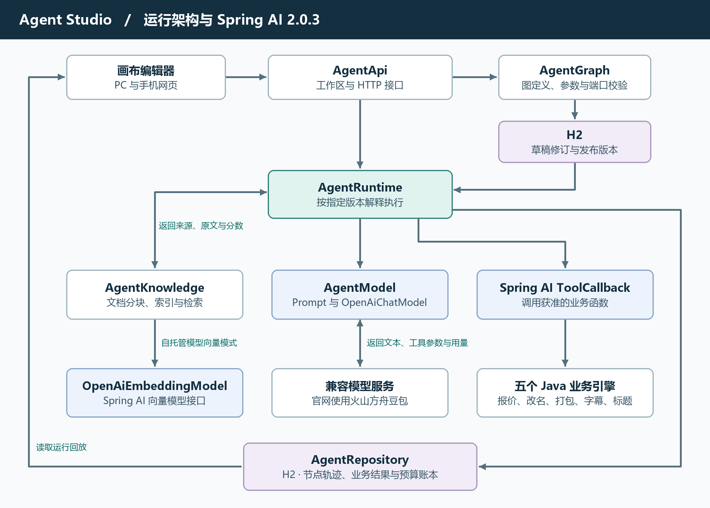
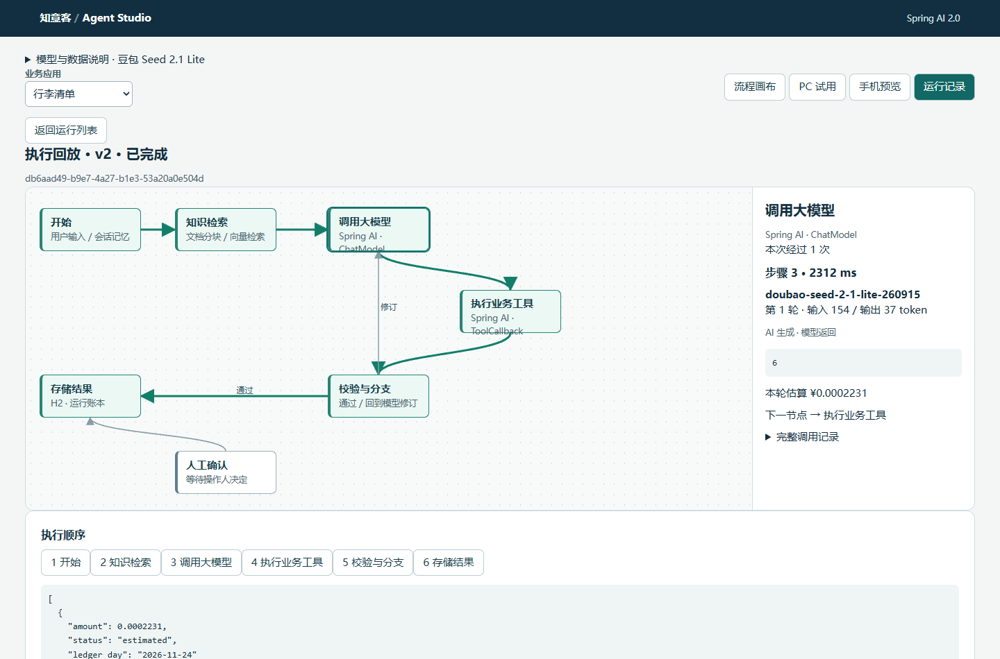

# Agent Studio 的技术架构与 Spring AI 2.0.3 实践

## 项目介绍

Agent Studio 是一套基于 Spring AI 2.0.3 的可视化业务 Agent 工作台。开发者在画布上连接输入、知识检索、模型、Java 工具、校验、人工确认和存储节点，再发布一个可执行版本。用户从 PC 或手机提交任务后，可以沿实际经过的节点检查依据、调用、结果和费用。社区版提供报价计税、批量改名、行李清单、字幕时间轴和标题检查五个工具。[在线工作台](https://aitools.ynsmhy.com/open-source/) · [发布版本源码](https://github.com/hellomaybe/Agent-Studio/tree/v0.2.0)

## 技术架构

这张图描述 v0.2.0 的 `agent-workbench` 模块。它使用 JDK 17 的 HTTP 服务接收请求，前端用 JavaScript 和 SVG 绘制可操作的画布。仓库根目录的 `frontend/` 与 `backend/` 还提供另一套 Vue Flow 和 Spring Boot 会议/反馈编辑器，两套实现可以分别启动。[工作台入口](../agent-workbench/src/main/java/studio/lab/AgentApi.java) · [画布代码](../agent-workbench/site/graph.js) · [模块依赖](../agent-workbench/pom.xml)

| 技术层 | 实际职责 | 看哪里 |
| --- | --- | --- |
| 设计与发布 | 节点位置决定布局，端口连线决定下一步。草稿带修订号，发布后得到版本；每次运行读取指定版本。 | [图定义](../agent-workbench/src/main/java/studio/lab/AgentGraph.java)、[版本存储](../agent-workbench/src/main/java/studio/lab/AgentRepository.java) |
| 流程执行 | 运行时读取输入与可选的上次结果摘要，按边执行检索、推理和工具。校验失败可回到模型修订，也可进入人工确认。模型轮数、执行步数和预算限制循环。 | [执行器](../agent-workbench/src/main/java/studio/lab/AgentRuntime.java) |
| 知识与模型 | 检索器按图配置选择文档块，将来源和正文放入上下文。模型适配器构造系统消息和用户消息，记录模型回复、工具请求与用量。 | [知识检索](../agent-workbench/src/main/java/studio/lab/AgentKnowledge.java)、[模型适配](../agent-workbench/src/main/java/studio/lab/AgentModel.java) |
| 工具与数据 | 工具节点可绑定原始表单数据或上游模型输出。报价金额、改名模板、衣物数量等由各自的 Java 引擎计算。结果写入所配置的工作区结果集。 | [五个业务工具](../agent-workbench/src/main/java/studio/lab/Features.java) |
| 回放与成本 | 一次运行有独立编号；回放读取当时的图、分支、调用和结果。模型调用前预留预算，收到供应商 token 回执后按配置单价结算估算额。用量不明时保留预留。 | [运行与账本](../agent-workbench/src/main/java/studio/lab/AgentRepository.java) |

## Spring AI 在哪里发挥作用

| 能力 | Spring AI 接口 | Agent Studio 在其上完成的工作 |
| --- | --- | --- |
| 对话推理 | `OpenAiChatModel.call(Prompt)`、`SystemMessage`、`UserMessage` | 把业务输入、检索片段、工作区记忆摘要和上一轮校验意见组合为请求。官网通过兼容接口调用豆包。 |
| 原生函数调用 | `ToolDefinition`、`ToolCallback`、模型响应中的 `ToolCall` | 将当前图允许的一个业务函数告知模型，验证返回的函数名称和参数，再进入工具节点调用 Java 引擎。模型驱动的函数调用与显式工具节点两种模式都可以演示。 |
| RAG | 自托管模型向量模式使用 `OpenAiEmbeddingModel` 和 `EmbeddingRequest` | 工作台实现文档分块、按指纹缓存 H2 索引、余弦相似度、阈值和 Top-K。公网演示使用稀疏词频向量；接入 Embedding 服务后可演示模型向量和索引复用。 |
| 用量观测 | `ChatResponse` 的模型元数据与 `Usage` | 将输入、输出 token 关联到具体运行和轮次，再计算估算金额。供应商账单与用户支付属于另一个业务层。 |
| 结构化输出扩展示例 | 会议编辑器使用 `BeanOutputConverter` | 把会议任务映射为 Java 类型。此例位于会议编辑器，五工具工作台的原生函数路径使用工具的参数定义。 |

Spring AI 的版本可以直接从 Maven 依赖核对。框架中的工具调用、检索增强有多种实现路径。上述表格仅列出此仓库已经落地的路径。[项目 POM](../agent-workbench/pom.xml) · [Spring AI 2.0.3 官方版本](https://github.com/spring-projects/spring-ai/releases/tag/v2.0.3) · [工具调用文档](https://docs.spring.io/spring-ai/reference/2.0/api/tools.html) · [检索增强文档](https://docs.spring.io/spring-ai/reference/2.0/api/retrieval-augmented-generation.html) · [会议结构化输出代码](../backend/src/main/java/studio/agent/model/MeetingTaskExtractor.java)

## 用一次真实运行介绍它

2026 年 11 月 24 日公网验收时，行李 Agent 的一个 v2 流程收到了九天行程，检索命中《出行打包规范》。豆包通过原生函数调用请求 `packing_list`，返回参数 `{"text":"9"}`。工具按该版本的洗衣规则算出上衣 9 件、内衣 9 件，运行时校验通过并存储业务结果。方舟在这一轮返回输入 619、输出 208 个 token，按当时的配置单价估算为 0.0010568 元。这个数字只描述该次调用。

演示时，可以让观众自己修改“途中洗衣”，发布下一版本，并用相同天数从手机再跑一次。让观众在回放里指出模型提供的参数、Java 工具算出的数量和数据库保存的版本，会比逐一介绍类名更容易理解。下面的截图取自另一次独立的六天行程运行。[试用行李 Agent](https://aitools.ynsmhy.com/open-source/lab/agent/?app=packing-list)

## 技术评审时的能力边界

- **自主性**：当前属于受发布图约束的单 Agent 工作流。模型可为已授权工具生成参数，执行器决定允许的分支和循环。动态拆解目标、跨 Agent 委派与开放工具发现属于进一步扩展。
- **记忆与检索**：目前的会话上下文可以读取同一工作区、同一应用最近一次完成结果的摘要。对话全历史、跨应用长期画像与企业级知识库权限需要额外设计。
- **框架覆盖**：当前工作台使用模型、消息、工具和可选 Embedding API。高层 `ChatClient` / Advisor 链、Spring AI `VectorStore` 实现、MCP 接入和流式输出可作为后续独立示例。
- **工程化程度**：工作区隔离、不可变发布版本、受控回边、人工审批、估算账本和回放已经可运行。当前 H2 实现按单进程工作；重启时进行中的运行标为中断。工作流回归验证、模型效果的标注评测、线上分布式追踪是三项不同的能力。

## 可直接使用的一分钟讲解

> Agent Studio 展示了如何用 Spring AI 把一次模型调用做成可验证的业务流程。以行李清单为例，用户只说要旅行九天。后台先检索打包规范，再让豆包请求行李工具。天数由模型理解，件数由 Java 规则计算，最终结果连同版本和用量一起保存。开发者能在画布改变知识来源、提示词、工具参数和失败后的走向，发布后在 PC 或手机试用。技术评审时，我们可以打开同一次运行，看到模型实际读了什么、请求了哪个函数、为什么经过这条边，以及这次调用估算花了多少钱。
